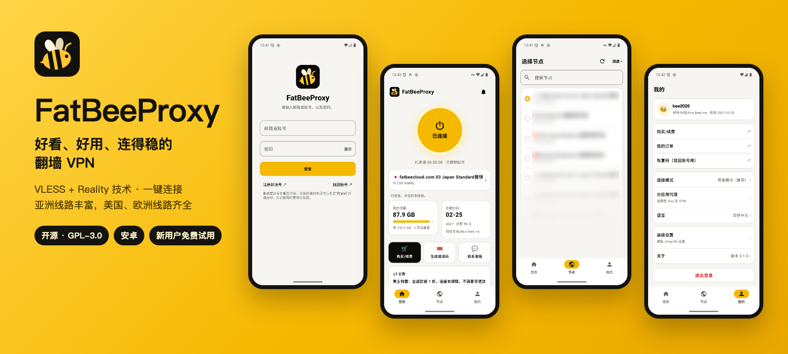
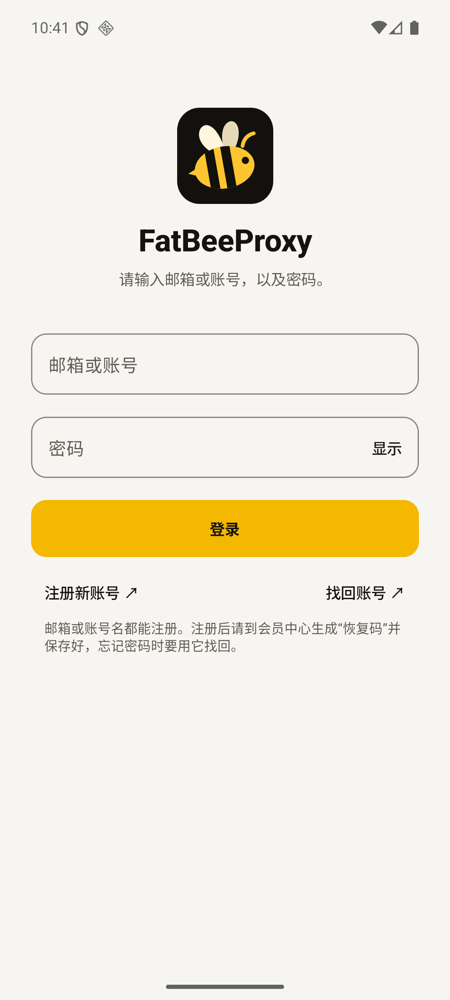
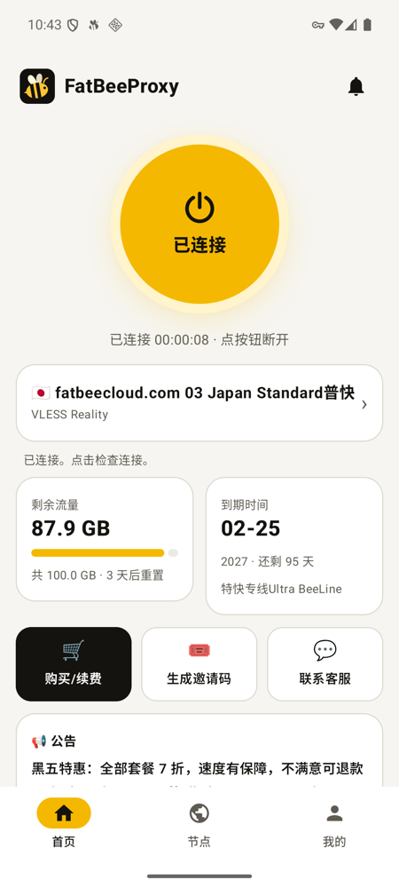
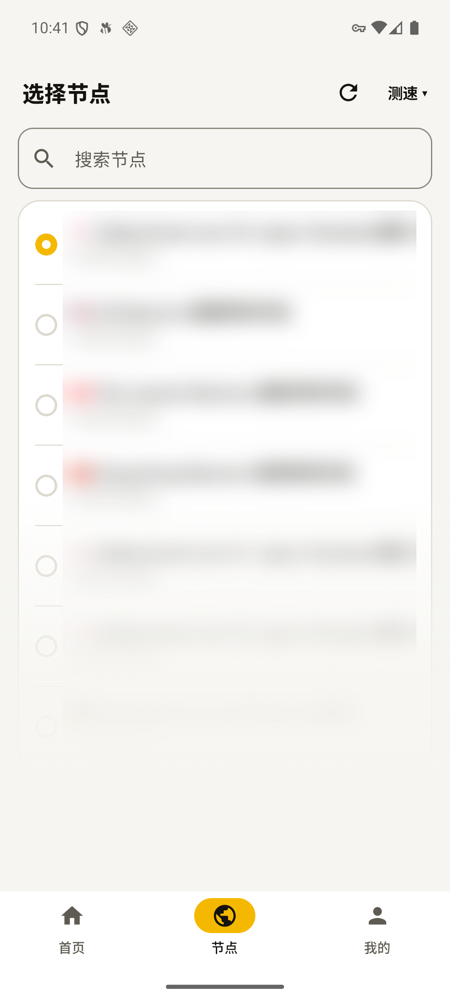
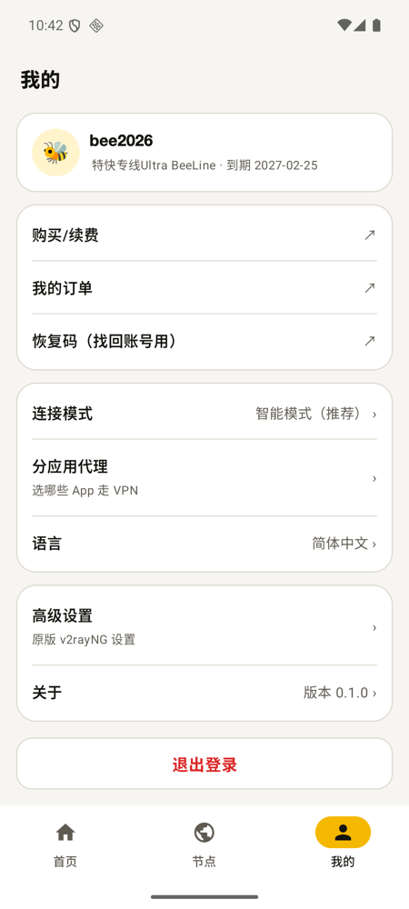

  

<h1 align="center">FatBeeProxy · 好看、好用、连得稳的翻墙 VPN</h1>

  安卓客户端 · VLESS + Reality · 亚洲线路丰富，美国、欧洲线路齐全 · 开源（GPL-3.0）

  <a href="https://fatbeecloud.com">官网</a> ·
  <a href="https://panel.fatbeecloud.com/#/register">注册账号</a> ·
  <a href="../../releases/latest">下载安卓版</a>

---

## 一、FatBeeProxy 是什么

FatBeeProxy 是一款专门为“翻墙”做的 VPN，**操作简单、界面好看，技术上安全稳定**。

- **打开就能用**：用账号登录后，线路自动出现，点中间的大按钮就连上了，不用自己导入任何东西。
- **快而且稳**：用的是目前最难被识别、最不容易被封的 **VLESS + Reality** 技术，线路做过专门优化，晚上高峰也稳。
- **线路选择多**：亚洲线路丰富（香港、日本多条），美国、加拿大、欧洲（德国）线路齐全。
- **常用服务都能用**：ChatGPT、Gemini、Claude、Google、YouTube 等打开就能用。
- **智能模式**：国内的网站和 App 直接连，国外的才走 VPN，不绕路、更省流量；需要时可以切到全局模式。
- **新账号免费试用**：注册后有免费试用，先试速度，满意再买（试用时长和流量以网站显示为准）。

### 🎟️ GitHub 读者专享优惠

看到这个页面的朋友，购买时在“优惠码”一栏填 **`FB20`**，享 **8 折**，长期有效。

👉 [注册账号](https://panel.fatbeecloud.com/#/register) → 在“购买订阅”里选好套餐 → 填优惠码 `FB20` → 支付宝或 PayPal 付款，付完马上能用。

---

## 二、给站长：Xboard 版安卓客户端（开源）

**你在用 [Xboard](https://github.com/cedar2025/Xboard) 面板运营机场？这就是一个现成的安卓 App。** 改一个配置文件、换上你的名字和图标，编译出来就是你自己品牌的客户端：会员用面板账号登录，线路自动出现，一键连接；**购买页直接使用你 Xboard 后台的套餐和价格**，你在后台改价格，App 里马上跟着变，不用改代码。

FatBeeProxy 由 **FatBeeCloud** 开发，连接内核基于知名开源项目 [v2rayNG](https://github.com/2dust/v2rayNG)（[Xray](https://github.com/XTLS/Xray-core) 内核），**全部源代码都在这个仓库里，遵循 GPL-3.0 开源**。

  
  
  
  

### 技术要点

- **协议**：以 VLESS + Reality（XTLS Vision）为主，也支持 Hysteria2、Trojan、Shadowsocks、VMess、WireGuard 等 Xray 支持的协议。
- **对接 [Xboard](https://github.com/cedar2025/Xboard) / V2Board 面板**：用面板账号登录（邮箱或账号名），自动拉取订阅、定时更新，显示剩余流量、到期时间和面板公告，支持生成邀请码；购买（使用面板后台的套餐、价格和收款方式）、注册、找回账号走面板网页，免密自动登录。
- **新界面**：首页一键连接、节点页测速（连通性测试 / TCP Ping）、智能 / 全局模式、浅色 / 深色、多语言。原版 v2rayNG 的全部高级设置都还在。

### 换个标就能用

如果你也在用 Xboard 面板运营服务，可以直接拿这份代码改成你自己的 App：

1. **对接你的面板**：改 `V2rayNG/gradle.properties` 里的 `fatbeePanelUrl`（面板地址）、`fatbeeWebsiteUrl`（官网）、`fatbeeSourceUrl`（你的源码地址）。其他选项的说明也写在这个文件里。
2. **换名字**：改 `V2rayNG/app/src/main/res/values*/strings.xml` 里的 `app_name`。
3. **换图标和颜色**：图标在 `res/drawable/ic_fatbee_*.xml` 和 `res/mipmap-*`，配色在 `ui/compose/Theme.kt`。
4. **换包名**：改 `V2rayNG/app/build.gradle.kts` 里的 `applicationId`。
5. **编译**：Fork 本仓库后，在 GitHub 的 Actions 里运行 “FatBee test build”，就能在云端编出安装包，不用自己装开发环境；也可以用 Android Studio 打开 `V2rayNG` 文件夹编译。正式发布请用你自己的签名密钥（见 `.github/workflows/fatbee-release.yml`，密钥放在 GitHub Secrets 里）。

和面板对接相关的代码都集中在 `V2rayNG/app/src/main/java/com/v2ray/ang/fatbee/` 目录，方便你改，也方便以后合并 v2rayNG 的新版本。

### 使用条件（请务必遵守）

本项目采用 **GPL-3.0** 许可证，并按 GPL-3.0 第 7 条附加了以下条款（全文见 [ADDITIONAL_TERMS.md](ADDITIONAL_TERMS.md)）：

1. **必须保留 FatBeeCloud 的署名**：源代码里的版权声明不得删除；改装版的 App“关于”页必须保留 “基于 FatBeeCloud 开发的 FatBeeProxy / Based on FatBeeProxy by FatBeeCloud” 这句话和本仓库链接。
2. **不得冒充**：改装版不得自称或伪装成 FatBeeCloud、FatBeeProxy 或 FatBeeCloud 的官方产品、官方服务。
3. **不得使用我们的名字和图标**：请换成你自己的 App 名称和图标。
4. **按 GPL-3.0 公开源代码**：改装后的 App 发给别人用，也要同样公开源代码，并保留 v2rayNG 原作者的版权声明。

> 服务器地址、密钥这些机密放在面板或 GitHub Secrets 里，不要写进代码。

### 版本二：独立版（即将推出）

不用 Xboard 面板？我们正在做 **独立版**：价格区由站长自己设定，App 直接接入易支付（支付宝）和 Google 支付，通过一套标准接口对接你自己的后台。做好后会放在这里。

---

## 三、安装教程

### 1. 下载

- 打开 [Releases](../../releases/latest)，下载 `FatBeeProxy-x.x.x.apk`（新旧安卓手机都能装）；
- 国内打不开 GitHub 的话，到 [官网](https://fatbeecloud.com) 下载。

### 2. 安装

1. 点开下载好的 `.apk` 文件；
2. 手机提示“是否允许此来源安装应用”，点 **允许**（只需要一次）；
3. 点 **安装**。

**国产手机会多几道提醒，照着点就行：**

| 手机 | 提示 | 怎么办 |
|---|---|---|
| 华为 / 荣耀 | “纯净模式”拦截 | 设置 → 系统和更新 → 纯净模式，选“仅本次安装”或暂时关闭 |
| 小米 / 红米 | “风险应用”“未经检测” | 点“继续安装”，有时要等几秒 |
| OPPO / 一加 / realme | 要求验证或扫描 | 点“继续安装”或“仍然安装” |
| vivo / iQOO | “未经官方检测” | 点“继续安装” |

这些是手机厂商对所有“不是从应用市场下载”的 App 的统一提醒，不是 App 有问题。

### 3. 登录和连接

1. 打开 FatBeeProxy，用账号登录；还没有账号就点“注册新账号”；
2. 登录后线路会自动出现；
3. 点首页中间的大按钮，第一次会弹出“允许建立 VPN 连接”，点 **确定**；
4. 按钮变成黄色、显示“已连接”，就可以上网了。

**小提示：**

- 想换线路：到“节点”页选一个就行；右上角“测速”可以看哪条最快。
- 连不上：先看首页有没有“套餐到期 / 流量用完”的提示；再试试换一条线路，或在节点页点刷新。
- 忘记密码：登录页点“找回账号”，用注册后生成的“恢复码”重置。

---

## 联系方式

有问题、想合作，或者想用这个 App 做你自己的品牌，欢迎用 Telegram 扫下面的二维码联系我们。

  

---

## 致谢

- [v2rayNG](https://github.com/2dust/v2rayNG)（GPL-3.0）— 本项目的基础
- [Xray-core](https://github.com/XTLS/Xray-core) / [AndroidLibXrayLite](https://github.com/2dust/AndroidLibXrayLite) — 连接内核
- [hev-socks5-tunnel](https://github.com/heiher/hev-socks5-tunnel) — 流量转发
- [Xboard](https://github.com/cedar2025/Xboard) — 面板

本项目遵循 [GPL-3.0](LICENSE) 许可证及 [附加条款](ADDITIONAL_TERMS.md)。
